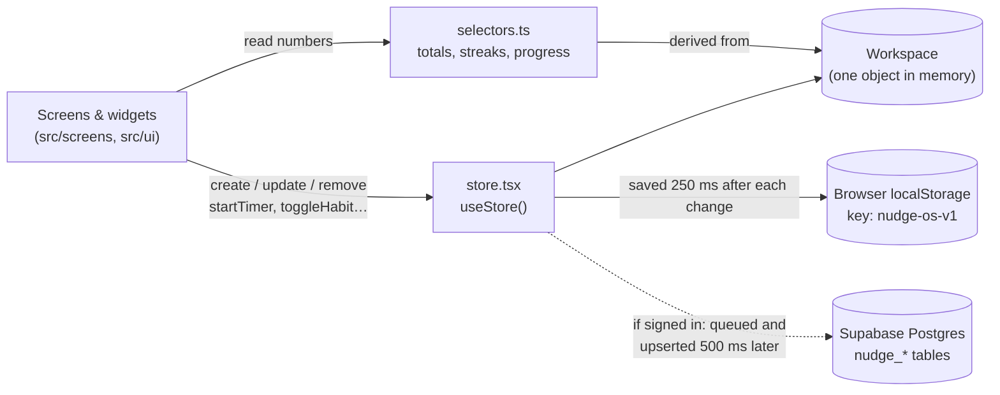
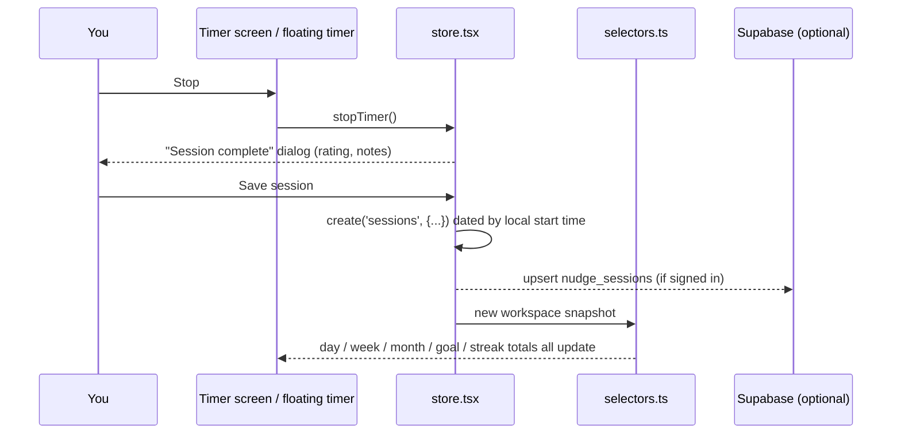
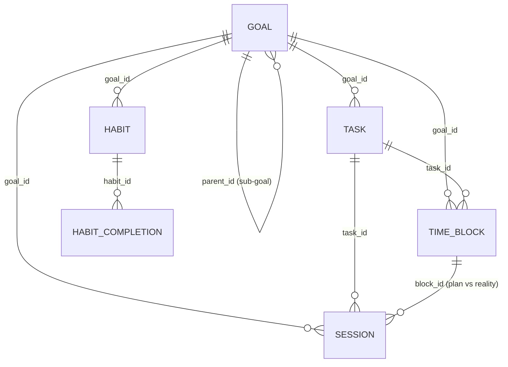

# Nudge — personal productivity OS

Nudge is one app that combines a **daily, weekly and monthly planner**, a **productive-hours timer**, **habits and streaks**, **goals and projects**, a **journal**, and **analytics**. Everything is built around one loop:

> **Plan → Track → Reflect → Improve**

The key idea: everything you record is attached to a date. A 45-minute coding session logged on September 28 is stored **once**. From that one record, the app works out the day total, the week total, the September total, the progress of the goal it belongs to, the planned block it fulfilled, the category breakdown, your streaks and every chart. Nothing is copied or stored twice.

**Project docs:** [PRD](docs/prd.md) · [Architecture](docs/architecture.md) · [Coding rules](docs/rules.md) · [Design](docs/design.md) · [Tasks & progress](docs/tasks.md) · [Project memory](docs/memory.md)

---

## Contents

1. [Quick start](#1-quick-start)
2. [Tech stack — everything used and why](#2-tech-stack--everything-used-and-why)
3. [Project structure](#3-project-structure)
4. [How the app works](#4-how-the-app-works)
5. [The data model](#5-the-data-model)
6. [Features and screens](#6-features-and-screens)
7. [The rules behind the numbers](#7-the-rules-behind-the-numbers)
8. [Setting up Supabase (accounts and sync)](#8-setting-up-supabase-accounts-and-sync)
9. [Deploying to Vercel](#9-deploying-to-vercel)
10. [Scripts and quality checks](#10-scripts-and-quality-checks)
11. [Extending the project](#11-extending-the-project)
12. [Troubleshooting](#12-troubleshooting)
13. [Known limitations](#13-known-limitations)

---

## 1. Quick start

**You need:** [Node.js](https://nodejs.org) **20.19 or newer** (or 22.12+), which includes `npm`. Check with `node -v`.

```bash
git clone https://github.com/chaithrareddy7/nudge-habit-tracker.git
cd nudge-habit-tracker
npm install          # downloads the libraries listed in package.json
npm run dev          # starts the app at http://localhost:5173
```

Open the URL that appears in the terminal. The first screen is **onboarding**:

- Fill it in (name → daily/weekly/monthly hour targets → first goals → habits), **or**
- Click **Explore with sample data** to load about six weeks of realistic activity, so every chart and streak has something to show.

That's all you need to use the app on one computer. Your data is saved in the browser. To get accounts and sync across devices, add Supabase ([section 8](#8-setting-up-supabase-accounts-and-sync)).

---

## 2. Tech stack — everything used and why

### Core

| Tool | Version | What it is | How Nudge uses it |
| --- | --- | --- | --- |
| **React** | 19 | UI library: you describe screens as components, and React updates the page when data changes | Every screen and widget is a React component (`src/screens`, `src/ui`, `src/shell`) |
| **TypeScript** | 6 | JavaScript with types; catches mistakes before the code runs | All source files are `.ts`/`.tsx`. The data model in `src/lib/model.ts` is the contract the whole app follows |
| **Vite** | 8 | Dev server and build tool; reloads instantly while you edit and bundles the app for production | `npm run dev` / `npm run build`. Config in `vite.config.ts` |
| **React Router** | 7 | Maps URLs to screens without reloading the page | Routes like `/today`, `/plan/week`, `/goals/:id` are defined in `src/App.tsx`; deep-link helpers live in `src/lib/routes.ts` |

### Libraries

| Library | What it is for | Where |
| --- | --- | --- |
| **@supabase/supabase-js** | Talks to Supabase (hosted Postgres database + login) | `src/lib/supabase.ts` creates the client; `src/lib/store.tsx` syncs data; `src/LoginPage.tsx` handles sign-in |
| **date-fns** | Date maths (start of week, add months, formatting) | Wrapped by `src/lib/dates.ts` so the whole app uses **local** dates consistently |
| **recharts** | Charts (bar, line, area, donut) | Analytics, Insights, Week/Month planners, Goal and Habit detail, Timer, Journal |
| **framer-motion** | Animations | Page transitions, modals, toasts and the floating timer (`src/ui/kit.tsx`, `src/shell/AppShell.tsx`) |
| **lucide-react** | Icon set | Every icon in the UI |
| **vite-plugin-pwa** | Makes the app installable ("Add to Home Screen") and able to load offline | Configured in `vite.config.ts`; generates `sw.js` and `manifest.webmanifest` at build time |

### Developer tools

| Tool | Purpose |
| --- | --- |
| **oxlint** | Very fast linter that flags likely bugs (`npm run lint`). Rules in `.oxlintrc.json` |
| **@vitejs/plugin-react** | Lets Vite compile JSX and hot-reload React components |
| **@types/\*** | Type definitions for React and Node |
| **tailwindcss / @tailwindcss/vite** | Still installed and registered in `vite.config.ts`, but **not used**: no CSS file imports Tailwind any more. It is safe to remove both packages and the plugin line |

### Styling

Plain CSS files using **CSS variables (design tokens)**. No CSS framework.

- `src/styles/theme.css` defines every colour, radius, shadow and font once, for **light** and **dark** mode, plus shared component styles (`.card`, `.btn`, `.chip`, `.modal`…).
- Each screen has its own small CSS file next to it (`src/screens/today.css`, …) whose class names start with the screen's name (e.g. `today-`), so styles never clash.
- Fonts (loaded from Google Fonts in `src/index.css`): **DM Sans** (body text), **Manrope** (headings), **Fraunces** (serif display numbers and dates), **JetBrains Mono** (timer clock).
- Category colours use a fixed 8-colour palette chosen to stay distinguishable for colour-blind users, with matching dark-mode shades.

### Backend (optional)

**Supabase** provides a Postgres database, email magic-link and Google sign-in, and **Row Level Security** (database rules that make each user's rows visible only to that user). The app works fully without it.

---

## 3. Project structure

```text
nudge-habit-tracker/
├── index.html                 # The single HTML page; React mounts into <div id="root">
├── vite.config.ts             # Vite + React + PWA (installable app) settings
├── vercel.json                # Hosting settings for Vercel (routing, caching)
├── package.json               # Libraries and npm scripts
├── .env.example               # Template for the Supabase environment variables
├── public/                    # Copied as-is into the build (favicon, icons)
├── supabase/migrations/       # SQL that creates the database tables (see section 8)
└── src/
    ├── main.tsx               # Entry point: renders <App/>
    ├── App.tsx                # Providers, theme, onboarding gate, all routes (screens lazy-loaded)
    ├── LoginPage.tsx          # Email magic-link + Google sign-in
    ├── index.css              # Loads fonts and theme.css
    ├── auth.css               # Login page styles
    │
    ├── lib/                   # ── The "brain": no UI in here ──
    │   ├── model.ts           # Types for every entity + defaults (targets, categories, reminders)
    │   ├── store.tsx          # App state: save to browser, sync to Supabase, timer, actions
    │   ├── selectors.ts       # Every calculation: totals, streaks, goal progress, plan vs actual
    │   ├── dates.ts           # Local date keys (yyyy-MM-dd) and duration formatting
    │   ├── routes.ts          # URL helpers, e.g. routes.day('2026-09-28')
    │   ├── sample.ts          # Generates the "Explore with sample data" workspace
    │   └── supabase.ts        # Creates the Supabase client from env variables (or null)
    │
    ├── shell/                 # ── The frame around every screen ──
    │   ├── AppShell.tsx       # Sidebar, search bar, mobile tab bar, Quick Add, floating timer, stop dialog, tab titles
    │   ├── PlannerTabs.tsx    # Day / Week / Month / Calendar switcher; /plan remembers the last view
    │   ├── ErrorBoundary.tsx  # A crashing screen shows a recovery card instead of a blank page
    │   ├── editors.tsx        # Shared create/edit forms (task, habit, goal, event, block, session, note, timer, categories)
    │   ├── background.tsx     # Reminders checker + streak celebrations
    │   └── Onboarding.tsx     # First-run setup
    │
    ├── ui/                    # ── Reusable building blocks ──
    │   ├── kit.tsx            # Page, Card, Button, Modal, ProgressBar, Ring, Stars, DateStepper, ChartTooltip, toasts…
    │   └── widgets.tsx        # HabitChecklist, TaskChecklist, PlanVsReality, StreakList, GoalRow, GettingStarted
    │
    ├── screens/               # ── One file (+ CSS) per page ──
    │   ├── Today.tsx  Timer.tsx  DayPlanner.tsx  WeekPlanner.tsx  MonthPlanner.tsx  Calendar.tsx
    │   ├── Goals.tsx  Habits.tsx  Tasks.tsx  Journal.tsx
    │   ├── Analytics.tsx  Insights.tsx  Search.tsx  Settings.tsx  Guide.tsx
    │   ├── planner-shared.tsx, planner-utils.ts   # Shared by week/month/calendar
    │   └── charts.tsx, chartUtils.ts              # Shared by analytics/insights
    │
    └── styles/theme.css       # Design tokens (light + dark) and shared component styles
```

`src/assets/` (hero.png, react.svg, vite.svg) are leftovers from the Vite template and aren't used.

---

## 4. How the app works

### The big picture



1. **One workspace object.** All your data (goals, tasks, blocks, sessions, habits, journal, and so on) lives in a single `Workspace` object (`src/lib/model.ts`). Any component can read it through `useStore()`.
2. **Changes go through the store.** Screens never edit data directly. They call `create`, `update`, `remove`, or a domain action such as `startTimer`, `toggleHabit` or `saveJournal` (`src/lib/store.tsx`).
3. **Numbers are calculated, never stored.** Totals, streaks and progress come from pure functions in `src/lib/selectors.ts`, for example `secondsIn(ws, from, to)`, `goalProgress(ws, goal)` or `productivityStreak(ws)`. Change a session and every screen updates.
4. **Local-first.** Every change is written to your browser's storage immediately, so the app works offline and without an account.
5. **Cloud sync (optional).** When you're signed in, each change is also queued and sent to Supabase in the background. The cloud icon in the top bar shows the sync state.

### How a change flows (example: stopping the timer)



### Dates: why there's a `dates.ts`

Every record uses a **local date key** like `2026-09-28`. The common shortcut `new Date().toISOString().slice(0, 10)` gives the **UTC** date, so a session at 11 pm in India would be counted on the next day. All date logic therefore goes through `src/lib/dates.ts` (`todayKey()`, `toKey()`, `weekStartKey()`…). Weeks start on **Monday**.

### Sync in detail (`store.tsx`)

- **Signing in** loads your account's data. If the account is **empty**, the data on this device is uploaded instead. If the account already has data, the **cloud copy replaces** this device's copy.
- **Every change** is added to a queue and sent about 500 ms later, in batches, as upserts keyed on `(user_id, id)`. Parent tables are sent before child tables (goals before tasks before sessions), so the database's same-user links are always satisfied.
- **Returning to the tab** re-downloads your data (only when nothing is waiting to upload), which picks up changes made on another device.
- **Settings** (targets, theme, the running timer, reminder preferences) live in one `profiles.settings` JSON column.
- **If sync fails**, a banner explains why, and nothing is lost: the browser copy is always the working copy.

### The running timer

There is only ever one timer: `settings.active_timer`. It stores the time already banked plus `resumed_at` (or `null` while paused). Because the timer is part of your saved settings, it **survives page reloads and follows you between devices**. Stopping it from any screen opens the same "Session complete" dialog. Sessions under one minute are not saved.

### Shared editors

`src/shell/editors.tsx` holds one form per entity. Any screen opens them the same way:

```tsx
const { open } = useEditors()
open({ kind: 'task', defaults: { date: '2026-09-28' } })   // new task on that day
open({ kind: 'goal', id: goal.id })                          // edit an existing goal
open({ kind: 'timer', defaults: { goal_id, category } })     // "What are you working on?"
```

Quick Add (the **+** button, or press **N**) uses the same forms, which is why it can create anything from anywhere.

### Screens load on demand

`App.tsx` loads each screen with `React.lazy`, so the first page load only downloads the app frame and the screen you open.

---

## 5. The data model

All types are defined in `src/lib/model.ts`. Field names are **snake_case** so they match the database columns exactly. That means no translation layer between the app and the database.

| Entity | What it represents | Key fields | Database table |
| --- | --- | --- | --- |
| **Settings** | Your preferences | `target_minutes_day/week/month`, `min_minutes_day` (streak minimum), `theme`, `active_timer`, timeline hours | `profiles.settings` (JSON) |
| **Category** | Work, Coding, Learning, Study, Creative, Exercise, Personal, plus any you add | `name`, `color` | `nudge_categories` |
| **Goal** | A long-term, monthly or weekly goal, or a project | `horizon`, `target_hours`, `weekly_target_hours`, `parts` (breakdown, e.g. Design 8h), `parent_id`, `deadline`, `status` | `nudge_goals` |
| **Task** | A to-do, optionally on a date | `date` (`null` = backlog), `done`, `goal_id`, `priority` 0–3, `estimate_minutes`, `reminder_time` | `nudge_tasks` |
| **TimeBlock** | A planned slot on a day | `date`, `start_min`/`end_min` (minutes after midnight), `kind` focus/break, `category`, `goal_id`, `task_id` | `nudge_time_blocks` |
| **PlannerEvent** | Meetings, appointments | `date`, `start_min`/`end_min` (`null` = all day), `important`, `reminder` | `nudge_events` |
| **ProductiveSession** | Tracked focus time | `date`, `started_at`, `ended_at`, `duration_seconds` (excludes pauses), `category`, `goal_id`, `goal_part_id`, `block_id`, `rating` 1–5, `notes`, `label`, `source` timer/manual | `nudge_sessions` |
| **Habit** | A recurring ritual | `frequency` (daily / n times per week / specific weekdays), `target_amount` + `unit` (e.g. 8 glasses), `reminder_time`, `start_date`/`end_date`, `goal_id`, `archived` | `nudge_habits` |
| **HabitCompletion** | One habit on one day | `habit_id`, `date`, `amount` | `nudge_habit_completions` |
| **JournalEntry** | The daily reflection | `mood`, `energy`, `body`, `went_well`, `distractions`, `tomorrow_priority`, `highlights`, `challenges`, `gratitude`, `notes`, `photos` | `nudge_journal_entries` |
| **Note** | A quick thought, optionally on a day | `text`, `date` | `nudge_notes` |
| **DayPlan** | Per-day overrides | `target_minutes`, `focus` (main focus for the day) | `nudge_day_plans` |
| **Review** | Weekly or monthly review | `period`, `start`, `answers`, `target_minutes` override | `nudge_reviews` |
| **Reminder** | Routine prompts | `kind` (journal, planning, weekly/monthly review, custom), `time`, `days`, `enabled` | `nudge_reminders` |

**How the pieces connect:**



Days, weeks, months and years are **not** tables. They're calculated from the `date` on each row. Deleting a goal **unlinks** its tasks, blocks, sessions and habits rather than deleting them, so your history stays intact.

---

## 6. Features and screens

**Global features, available on every screen:**

- **Quick Add**: the **+** button or **N**. Creates a task, habit, goal, event, time block, timer, past session, journal entry or note.
- **Search**: the top bar, or **/**.
- **Timer shortcut**: **T** opens the timer.
- **Floating live timer**: shows on every page except Today and Timer.
- **Mobile tab bar**: Today → Timer → Planner → Habits → More.
- **Guide** (`/guide`): the in-app user manual, covering every feature, why to use it and how, plus a suggested routine, shortcuts and FAQ.
- **Getting started** card on Today for new accounts: set a goal → add a habit → plan a block → track time → check off a habit → reflect. It hides itself when done or dismissed.

| Screen | URL | What you can do |
| --- | --- | --- |
| **Today** | `/today` | Greeting and date, main focus, productive time vs target (ring), start/pause/stop the timer, today's schedule with a "now" line, tasks, habits, active goals, streaks, upcoming events, quick mood check-in, and a summary of the day's numbers |
| **Focus timer** | `/timer` | "What are you working on?" (category → goal → part → label → start). Shows the planned block happening now. Big live clock, pause/resume/stop, today's sessions and history, edit any session, **log time manually** |
| **Planner** | `/plan` | One sidebar entry with four views (tabs at the top): Day, Week, Month, Calendar. `/plan` opens the view you used last |
| **Day planner** | `/plan/day?date=…` | Hour-by-hour timeline: **drag** to move, **drag the bottom edge** to resize, **drag on empty space** to create. Planned and tracked time side by side. Per-day target and focus, tasks plus backlog, habits, events, notes, plan vs reality, the daily reflection form |
| **Week planner** | `/plan/week?date=…` | Monday–Sunday columns: hours vs target, editable daily targets, blocks, events, tasks and habits per day. **Drag tasks and blocks between days** (or use the "Move to…" menu). Weekly target, weekly goals, plan vs reality, **Weekly review**, and **Plan next week** (carry over unfinished tasks, copy focus blocks, set next week's target and focus) |
| **Month planner** | `/plan/month?date=…` | Calendar with hours, a heat tint, habit dots, journal and goal markers, and important events per day. Monthly target, monthly goals, category donut, daily-hours chart, **Monthly review** |
| **Calendar** | `/calendar?view=day\|week\|month` | Unified calendar; every date opens its day planner |
| **Goals** | `/goals`, `/goals/:id` | Filter by type and status. Detail page: progress ring, pace check (ahead / on track / behind), hours over time vs ideal pace, breakdown by part, linked tasks, habits and sub-goals, planned blocks, recent sessions, mark complete or archive |
| **Habits** | `/habits`, `/habits/:id` | Today's check-in, cards with a 12-week heatmap (click a cell to toggle that day). Detail page: current and best streak, 7/30/90-day completion rates, month calendar history, weekly and monthly performance charts |
| **Tasks** | `/tasks` | Today / Upcoming / Backlog / Overdue / Completed. Search and filters, quick reschedule, start a timer on a task, "Move overdue to today" |
| **Journal** | `/journal?date=…` | Mood, energy, guided prompts, gratitude, photos (resized to 1024 px, up to 8 per day), autosave. Shows what actually happened that day, a mood/energy trend, and searchable history |
| **Analytics** | `/analytics?tab=today\|week\|month\|all` | Stats and charts per period: hours by day and category, planned vs actual, best day and time of day, a weekday × hour heatmap, monthly and weekly trends. Every chart has a "View as table" option |
| **Insights** | `/insights` | Plain-language insights, "What to focus on next", streaks with milestone progress, comparisons (week, month, year vs the previous one), planning accuracy |
| **Search** | `/search?q=…` | Searches everything. Category or goal names ("coding") show a time summary. Dates and periods ("September", "last week", "2026-09-28", "sep 28") show that period's stats |
| **Settings** | `/settings` | Name, account, theme (light / dark / system), timeline hours, targets, categories, reminders, browser notifications, export JSON, **import backup**, load sample data, start fresh, re-run setup |
| **Guide** | `/guide` | Searchable user manual for every feature |

---

## 7. The rules behind the numbers

All of these live in `src/lib/selectors.ts`.

| Concept | Rule |
| --- | --- |
| **Productive time** | Sum of session `duration_seconds` (paused time is excluded). Today's total also includes the running timer. |
| **Daily / weekly / monthly target** | The default from Settings, unless overridden for that specific day (DayPlan), week or month (Review). |
| **Productivity streak** 🔥 | Consecutive days with at least the **streak minimum** (default 2 h). Today not yet reaching it doesn't break the streak. |
| **Weekly streak** 🎯 | Consecutive weeks that reached their weekly target. The current week only counts once it's met. |
| **Habit streak** | Daily and specific-day habits count consecutive **scheduled** days completed; "n times per week" habits count consecutive weeks that hit n. Today, or this week, being incomplete doesn't break it. |
| **Goal / category streak** | Consecutive days with any tracked time on that goal or category. |
| **Habit done** | `amount ≥ target_amount` (e.g. 8 of 8 glasses). Partial amounts show as a partly filled circle. |
| **Goal progress** | If the goal has target hours: tracked hours ÷ target (sessions from the goal's start date, including sub-goals). Otherwise: tasks done ÷ tasks. A completed goal shows 100%. |
| **Plan vs reality** | Planned = total length of **focus** blocks; Actual = tracked sessions; **Efficiency = actual ÷ planned**. Shown per category with over/under amounts. "Followed through" = share of planned blocks that got at least half their length in linked sessions. |
| **Auto-linking** | Starting the timer during a planned focus block links the session to that block when the category or goal matches, so plan vs reality works without extra steps. |
| **Celebrations** | A subtle toast at streak milestones (3, 7, 14, 21, 30, 50, 75, 100, 150, 200, 365) and once when you beat your personal best. |
| **Reminders** | Checked every 20 seconds while the app is open: habits and tasks at their time, time blocks at their start, events 10 minutes before, and journal / planning / weekly / monthly review prompts (the monthly one on the last day of the month). Shown in-app, plus a browser notification if you allow it in Settings. |

---

## 8. Setting up Supabase (accounts and sync)

Skip this section if you only want to use the app locally.

### 8.1 Create the project

1. Sign up at [supabase.com](https://supabase.com) and create a project. (This repo is already pointed at project `jombigwxqzgslqryblai`.)
2. Go to **Project Settings → API** and copy:
   - the **Project URL** (`https://<project-ref>.supabase.co`)
   - the **anon / publishable** key. This key is meant for the browser. It is safe to expose because Row Level Security protects the data.
   - ⚠️ **Never** use the `service_role` / secret key in this app. It bypasses all security.

### 8.2 Environment variables

Copy the template and fill it in:

```bash
cp .env.example .env
```

```env
VITE_SUPABASE_URL=https://<project-ref>.supabase.co
VITE_SUPABASE_ANON_KEY=<your anon or publishable key>
```

Vite only exposes variables whose names start with `VITE_` to the browser code. `.env` is git-ignored, so it won't be committed. Restart `npm run dev` after editing it.

If these variables are missing, `src/lib/supabase.ts` returns `null` and the app runs in local-only mode.

### 8.3 Create the database tables

The app uses the tables created by **`supabase/migrations/20261001000000_nudge_productivity_os.sql`**.

**Option A — SQL Editor (easiest):** open `https://supabase.com/dashboard/project/<project-ref>/sql/new`, paste the **whole file**, and click **Run**. It is safe to run more than once.

**Option B — Supabase CLI:**

```bash
npx supabase login
npx supabase link --project-ref <project-ref>
npx supabase db push
```

`db push` applies every file in `supabase/migrations/` in order:

| File | What it does | Used by the current app? |
| --- | --- | --- |
| `20260928000000_initial_schema.sql` | `profiles` table plus a trigger that creates a profile on signup; the original habits, tasks, focus_sessions and weekly_reviews tables | `profiles` only |
| `20260929000000_productivity_os.sql` | Tables from an earlier version of the app | No |
| `20260930000000_goal_ownership_guards.sql` | Triggers for those earlier tables | No |
| `20261001000000_nudge_productivity_os.sql` | **The 13 `nudge_*` tables**, `profiles.settings`, indexes and security policies | **Yes** |

**What the migration guarantees:**

- Each table's key is `(user_id, id)`.
- **Row Level Security** on every table allows `user_id = auth.uid()` only, so users can never read or write each other's rows.
- **Same-user foreign keys**, such as `(user_id, goal_id) → nudge_goals(user_id, id)`, make it impossible to link to another user's goal.
- Deleting a goal sets `goal_id` to null on its tasks and sessions instead of deleting them.

### 8.4 Enable sign-in

In **Authentication → Sign In / Providers**:

- **Email**: enable it. Users get a **magic link** (no password).
- **Google** (optional): create OAuth credentials in [Google Cloud Console](https://console.cloud.google.com/apis/credentials), set the authorized redirect URI to `https://<project-ref>.supabase.co/auth/v1/callback`, then paste the Client ID and Secret into Supabase.

In **Authentication → URL Configuration**, add every address the app runs on:

| Setting | Value |
| --- | --- |
| Site URL | your production URL, e.g. `https://nudge-habit-tracker.vercel.app` |
| Redirect URLs | `http://localhost:5173/**`, `https://nudge-habit-tracker.vercel.app/**`, and (for Vercel preview deployments) `https://*-<your-vercel-team>.vercel.app/**` |

The app asks Supabase to send users back to `<current site>/today` after sign-in. If that address isn't in the list, Supabase sends them to the Site URL instead.

---

## 9. Deploying to Vercel

Nudge is a **static single-page app**: `npm run build` produces plain HTML, CSS and JS in `dist/`. Vercel serves those files; Supabase is the backend. No server code is involved.

### What `vercel.json` does

| Setting | Why |
| --- | --- |
| `framework: vite`, `buildCommand: npm run build`, `outputDirectory: dist` | Tells Vercel how to build the app |
| `installCommand: npm ci` | Installs the exact versions in `package-lock.json` |
| **Rewrite `/(.*)` → `/index.html`** | Routes like `/plan/week` exist only in the browser (React Router). Without this rewrite, refreshing or opening a deep link returns **404**. Real files (JS, CSS, icons) are still served directly, because Vercel checks for a real file before applying rewrites. |
| `sw.js` → `max-age=0` | Makes browsers always check for a new service worker, so people get updates |
| `/assets/*` → cached for a year | These file names contain a content hash, so they never change |

### Step 1 — Push the code to GitHub

Vercel deploys from your Git repository. The current version of the app is **not committed yet**, so commit and push it first:

```bash
git checkout -b productivity-os            # optional: work on a branch
git add -A
git commit -m "Rebuild Nudge as a productivity OS + Vercel config"
git push -u origin productivity-os         # or: git push origin main
```

Before `git add -A`, check `git status`. The `.archify/` folder contains locally generated diagrams; add `.archify/` to `.gitignore` if you don't want to commit them. `.env` is already ignored.

### Step 2 — Import the project into Vercel (dashboard)

1. Go to [vercel.com/new](https://vercel.com/new) and sign in with GitHub.
2. Choose **Import** next to `nudge-habit-tracker`. If it's missing, click **Adjust GitHub App Permissions** and grant access to the repo.
3. **Framework Preset:** Vite (detected automatically; `vercel.json` sets it too).
4. **Root Directory:** leave as `./`.
5. **Build and Output Settings:** leave the defaults; `vercel.json` provides `npm ci`, `npm run build` and `dist`.
6. **Environment Variables**: add both, ticked for **Production** and **Preview**:

   | Name | Value |
   | --- | --- |
   | `VITE_SUPABASE_URL` | `https://<project-ref>.supabase.co` |
   | `VITE_SUPABASE_ANON_KEY` | your anon / publishable key |

7. Click **Deploy**. The build takes about a minute, and you'll get a URL like `https://nudge-habit-tracker.vercel.app`.

> `VITE_` variables are baked into the JavaScript **at build time**. If you add or change them later, you must **redeploy** (Deployments → ⋯ → Redeploy) for the change to take effect.

### Step 3 — Point Supabase at the new URL

In Supabase → **Authentication → URL Configuration**:

- set **Site URL** to your Vercel URL;
- add `https://<your-app>.vercel.app/**` (and your custom domain, if any) to **Redirect URLs**.

Without this, magic links and Google sign-in send people back to `localhost`.

### Step 4 — Check the deployment

- Open `https://<your-app>.vercel.app/plan/week` directly and refresh. It should load, not 404.
- Sign in with a magic link. You should land back on `/today` on the Vercel URL.
- The cloud icon in the top bar should be solid, with no "Couldn't sync" banner. If you see the banner, apply the migration (section 8.3).
- On a phone, use **Add to Home Screen**. The app installs like a native app (PNG icons for iOS and Android are in `public/`).

### Optional — deploy from the command line instead

```bash
npm i -g vercel
vercel login
vercel link                        # connect this folder to a Vercel project
vercel env add VITE_SUPABASE_URL production
vercel env add VITE_SUPABASE_ANON_KEY production
vercel --prod                      # build and deploy to production
```

### After the first deploy

- **Every push to `main`** deploys to production automatically.
- **Every other branch or pull request** gets its own **preview URL**. Add that URL pattern to Supabase's Redirect URLs if you want sign-in to work on previews.
- **Custom domain:** Vercel project → **Settings → Domains** → add your domain and follow the DNS instructions, then add the domain to Supabase's Redirect URLs.
- **Node version:** Vercel's default (22.x) works. Vite 8 needs 20.19 or newer, so don't pick an older version under **Settings → General → Node.js Version**.

---

## 10. Scripts and quality checks

| Command | What it does |
| --- | --- |
| `npm run dev` | Development server with instant reload (default `http://localhost:5173`; use `npm run dev -- --host` to open it on your phone over Wi-Fi) |
| `npm run build` | Type-checks everything (`tsc -b`), then builds the production files into `dist/` |
| `npm run preview` | Serves the `dist/` build locally, the closest thing to production |
| `npm run lint` | Runs oxlint. The remaining warnings are "fast refresh" notices about files that export hooks alongside components; they're harmless |

Run `npm run build` and `npm run lint` before pushing. Vercel runs the same build, so if it fails locally it will fail there too.

---

## 11. Extending the project

### Add a new screen

1. Create `src/screens/MyScreen.tsx` with a default-exported component wrapped in `<Page title="…">` from `src/ui/kit.tsx`, plus `src/screens/myscreen.css` with class names prefixed `myscreen-`.
2. Register it in `src/App.tsx`: `const MyScreen = lazy(() => import('./screens/MyScreen'))` and `<Route path="/my-screen" element={<MyScreen />} />`.
3. Add a link helper in `src/lib/routes.ts` and a nav item in `src/shell/AppShell.tsx`.
4. Read data with `useStore()`, calculate with `selectors.ts`, and open forms with `useEditors().open(...)`.

### Add a field or a new entity

1. Add the field or type in `src/lib/model.ts` (and its default in `emptyWorkspace()` if it's a new collection).
2. For a new collection, add its table name to `TABLES` in `src/lib/store.tsx`, placed after any table it references.
3. Write a **new** migration file in `supabase/migrations/` (don't edit old ones once applied). Use `add column if not exists` or `create table if not exists`, the `(user_id, id)` key and the same RLS policy pattern.
4. Add any calculation to `selectors.ts`, not inside a component.

### Conventions

- Dates: always `src/lib/dates.ts`, never `toISOString().slice(0, 10)`.
- Colours: always CSS variables from `theme.css`, so dark mode keeps working. Data colours (categories, goals, habits) go through `useSeriesColor()`.
- Copy: calm and supportive, never shaming.

---

## 12. Troubleshooting

| Symptom | Cause | Fix |
| --- | --- | --- |
| *"Couldn't sync (… Could not find the table 'public.nudge_habits' in the schema cache)"* | The migration hasn't been applied to your Supabase project | Run `20261001000000_nudge_productivity_os.sql` in the SQL Editor (section 8.3). Wait about 30 s and refresh. Your data is safe in the browser meanwhile |
| Sign-in link opens `localhost` or "redirect not allowed" | Site URL / Redirect URLs not configured | Section 8.4 and Vercel step 3 |
| 404 when refreshing a page on Vercel | `vercel.json` missing from the deployed commit | Make sure `vercel.json` is committed at the repo root, then redeploy |
| Deployed app behaves as "local only" | Env variables missing, or added after the build | Add both `VITE_` variables in Vercel → Settings → Environment Variables, then **Redeploy** |
| An old version keeps showing after a deploy | The service worker cached the previous build | Reload once more (it updates in the background), or close and reopen the tab |
| Build fails with a Node error | Node too old | Use Node 20.19+ / 22.12+ locally and on Vercel |
| A screen shows "Something went wrong on this screen" | A bug in that screen; your data is unaffected | Press **Try again** or **Reload app**, and report the message shown |
| Signed in on a new device and the data looks different | By design, an account that already has data replaces this device's copy | Use Settings → **Export JSON** before signing in if you want a backup |
| "This device is out of storage space" | Many journal photos in browser storage | Remove some photos; browser storage is roughly 5 MB per site |

---

## 13. Known limitations

- **Reminders only fire while the app is open** (in a tab or as an installed app). Notifications while it's closed would need Web Push (VAPID keys) and a server-side sender, which aren't included.
- **Sync conflicts:** the last write wins per row. Editing the same item on two devices at the same moment keeps whichever save arrives last.
- **Photos** are stored inside the journal row (and therefore in browser storage). For heavy photo use, move them to Supabase Storage.
- **Drag and drop** on the week board uses the browser's native drag events, which phones don't support; on phones, use each item's "Move to…" menu instead.
