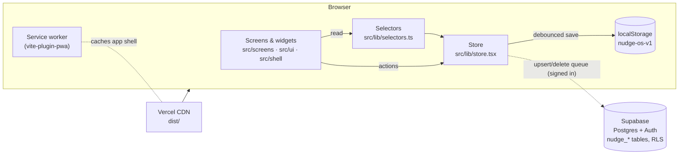
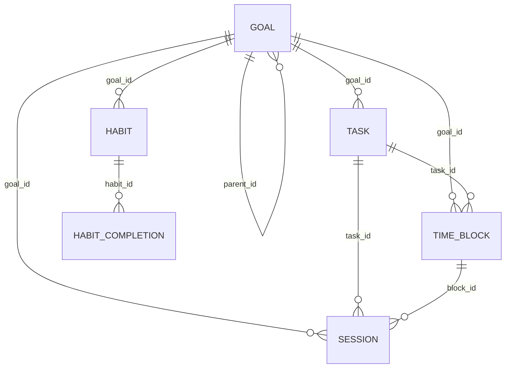

# Nudge — Architecture

How the system is built and why. Rules that follow from it are in [rules.md](rules.md).

## 1. Overview

Nudge is a **static single-page app** (React + TypeScript, built by Vite) backed optionally by **Supabase** (Postgres + Auth). There is no custom server.



## 2. Tech stack

| Layer | Choice |
| --- | --- |
| UI | React 19, React Router 7 (BrowserRouter), framer-motion, lucide-react |
| Language | TypeScript 6 (strict app config, `noUnusedLocals`) |
| Build | Vite 8, `@vitejs/plugin-react`, `vite-plugin-pwa` (Workbox generateSW) |
| Charts | Recharts 3 |
| Dates | date-fns 4, wrapped by `src/lib/dates.ts` |
| Styling | Plain CSS with design tokens (`src/styles/theme.css`) |
| Backend | Supabase (`@supabase/supabase-js` 2): Postgres, Auth (magic link, Google), RLS |
| Lint | oxlint |
| Hosting | Vercel (static), configured by `vercel.json` |

Tailwind (`tailwindcss`, `@tailwindcss/vite`) is installed and registered in `vite.config.ts` but **unused**; scheduled for removal.

## 3. Source layout and layers

```text
src/
  main.tsx, App.tsx        bootstrap · providers · routes (screens lazy-loaded) · theme sync · onboarding gate
  lib/                     domain layer: no JSX except store.tsx's provider
    model.ts               entity types + defaults (single source of truth for shapes)
    dates.ts               local date keys, durations, clock helpers
    selectors.ts           pure aggregation (totals, streaks, progress, plan vs actual, summaries)
    store.tsx              state container, persistence, sync, timer, domain actions
    routes.ts              URL builders
    sample.ts              deterministic sample workspace
    supabase.ts            client factory (null when env vars missing)
  shell/                   app frame: AppShell, editors (all create/edit modals), PlannerTabs,
                           ErrorBoundary, Onboarding, background (reminders, celebrations)
  ui/                      design system: kit.tsx (primitives), widgets.tsx (domain widgets)
  screens/                 one screen per file + its CSS; shared planner/chart helpers
  styles/theme.css         tokens (light/dark) + shared component CSS
```

**Dependency direction:** `screens → shell/ui → lib`. `lib` never imports from `ui`, `shell` or `screens`. Screens don't import other screens (exceptions: the planner views share `planner-shared.tsx`/`planner-utils.ts`; Analytics/Insights share `charts.tsx`/`chartUtils.ts`; DayPlanner embeds `JournalForm` from `Journal.tsx`).

## 4. Data model

Defined in `src/lib/model.ts`. Field names are snake_case and identical to database columns, so rows sync without mapping.



| Collection (`Workspace` key) | Table | Notes |
| --- | --- | --- |
| `settings` | `profiles.settings` (jsonb) | targets, theme, `active_timer`, milestone memory, `checklist_dismissed`, `dashboard` (Today layout per column count + hidden cards) |
| `categories` | `nudge_categories` | 7 built-ins (`cat-*` ids) + custom |
| `goals` | `nudge_goals` | `horizon`, `target_hours`, `weekly_target_hours`, `parts` (jsonb), `parent_id`, `status` |
| `tasks` | `nudge_tasks` | `date` null = backlog |
| `blocks` | `nudge_time_blocks` | `date` + `start_min`/`end_min` (minutes after midnight), `kind` focus/break |
| `events` | `nudge_events` | null start/end = all day |
| `sessions` | `nudge_sessions` | `date` (local), `duration_seconds` (excludes pauses), links to goal/part/task/block |
| `habits` | `nudge_habits` | `frequency` (jsonb union: daily / weekly{times} / custom{days}) |
| `completions` | `nudge_habit_completions` | `amount`; done when `amount ≥ target_amount` |
| `journal` | `nudge_journal_entries` | unique per date; `photos` jsonb (data URLs) |
| `notes` | `nudge_notes` | optional date |
| `days` | `nudge_day_plans` | per-day target override + main focus |
| `reviews` | `nudge_reviews` | `period` week/month, `answers` jsonb, target override |
| `reminders` | `nudge_reminders` | routine reminders (journal, planning, reviews, custom) |

**Derived, never stored:** days, weeks, months and years; totals; goal progress; streaks; plan vs actual; summaries.

### Database (migration `20261001000000_nudge_productivity_os.sql`)
- Primary key `(user_id, id)` on every table; `id` is text (UUIDs for user rows, stable ids for built-ins and samples).
- Composite foreign keys `(user_id, x_id) → parent(user_id, id)` make cross-user links impossible; goal/task/block deletes `SET NULL` on children; habit delete cascades completions.
- RLS on every table: `for all to authenticated using/with check (user_id = auth.uid())`.
- Idempotent (`if not exists`); creates `profiles` if missing; ends with `notify pgrst, 'reload schema'`.
- Legacy migrations `20260929…` and `20260930…` create tables the app doesn't use (kept for migration-history consistency).

## 5. State, persistence and sync (`store.tsx`)

- **Single `Workspace` in React state**, exposed through `useStore()` with a memoised API.
- **Writes** only through store actions: generic `create / update / remove` plus domain actions (`toggleHabit`, `setHabitAmount`, `saveJournal`, `setDayPlan`, `saveReview`, timer actions, `loadSample`, `importWorkspace`, `resetWorkspace`).
- **Referential integrity on delete** is handled in `remove()`: deleting a goal unlinks tasks, blocks, sessions, habits and child goals; deleting a habit removes its completions; and so on.
- **Local persistence**: the whole workspace is written to `localStorage['nudge-os-v1']` 250 ms after each change.
- **Sync queue** (signed in only): each change enqueues `{collection, kind, id}`; flushed 500 ms later. Ops are collapsed to the last per row, then sent **sequentially in dependency order** (upserts parents → children; deletes children → parents), each as a batched `upsert(onConflict: 'user_id,id')` / `delete().in('id')`. Settings are upserted into `profiles.settings`.
- **Pull**: on sign-in and on window focus (only when the queue is empty). Remote wins; an empty account adopts and uploads local data. `active_timer` falls back to local if the remote has none.
- **Replace semantics** (`replaceWorkspace`, used by sample load and import): deletes remote rows not present in the new workspace, upserts the rest.
- **Errors** set `sync = 'error'` with a user-readable banner; local data is never discarded.

### Timer
`settings.active_timer = { …links, started_at, accumulated_seconds, resumed_at | null }`. Live seconds = `accumulated + (now − resumed_at)`. `stopTimer()` pauses and sets `stopDraft`, which the shell's global StopDialog renders; `finishTimer()` creates the session (if ≥ 60 s) dated by the **local** start date.

## 6. Derivation layer (`selectors.ts`)

Pure functions of `(ws, …args)`. A `WeakMap<Workspace, Index>` caches per-snapshot indexes (seconds by day, sessions by day, completions by habit+day, first activity date), so repeated calls on one render are cheap.

Key functions: `secondsOn/In`, `sessionsOn/In`, `day/week/monthTargetMinutes`, `planVsActual`, `byCategory/byGoal/byDay/byHour/byWeekday`, `goalProgress`, `goalSessions` (from `start_date`, includes child goals), `habitScheduledOn/DoneOn/Streak/CompletionRate`, `habitsCompletion`, `productivityStreak`, `weeklyStreak`, `goal/categoryStreak`, `allStreaks`, `daySummary`, `periodSummary`, `change`.

Streak rule: walk units (scheduled days or weeks); the unfinished current unit never breaks a streak.

## 7. UI composition

- **App.tsx**: `BrowserRouter → StoreProvider → ToastProvider → EditorHost → ThemeSync → Gate`. The Gate shows the login page, a boot screen while the session loads, Onboarding until `settings.onboarded`, otherwise `AppShell`.
- **AppShell**: sidebar (Plan / Track / Reflect groups), topbar search, Quick Add, mobile tab bar (Today, Timer, Planner, Habits, More), `TimerDock`, `StopDialog`, PlannerTabs on planner routes, `ErrorBoundary` keyed by route, per-route `document.title`, reminders and celebrations hooks.
- **EditorHost** (`shell/editors.tsx`): one modal per entity, opened anywhere with `useEditors().open({ kind, id?, defaults? })`.
- **Screens** are `React.lazy` chunks behind `<Suspense>`.

### Routes
`/today`, `/timer`, `/plan` (→ last view), `/plan/day|week|month?date=`, `/calendar?view=&date=`, `/goals[/:id]`, `/habits[/:id]`, `/tasks`, `/journal?date=`, `/analytics?tab=&date=`, `/insights`, `/search?q=`, `/settings`, `/guide`, `/login`; unknown routes → `/today`. Build links with `src/lib/routes.ts`.

## 8. Background behaviour (`shell/background.tsx`)

- **Reminders (in-app)**: every 20 s the shared notification planner (`supabase/functions/push/planner.ts`, via `src/lib/notify.ts`) is run on a snapshot of today; due items show a toast (and a system notification if the tab is hidden). Skipped when this signed-in device has push on, so nothing arrives twice. Custom reminders always fire in-app. De-duplicated per day in `localStorage['nudge-reminders-fired']`.
- **Notification buttons**: links such as `/timer?do=start5` and `/today?do=start-block&id=…` start the timer and then tidy the URL (`useNotificationActions`). A `nudge-refresh` message from the service worker (after **✓ Done**) pulls fresh data.

## 8b. Push notifications

| Piece | Where | Role |
| --- | --- | --- |
| Planner | `supabase/functions/push/planner.ts` (+ `messages.ts`) | Pure TS shared by server and app: what's due for a day snapshot (prefs, nudge style, quiet hours, daily cap, send-once keys). Tested by `npm run test:notify` |
| Edge Function | `supabase/functions/push/index.ts` (Deno) | `tick` (pg_cron every 5 min, `x-push-secret`): loads subscriptions + today's data for each user in their timezone, asks the planner, logs the key, sends Web Push (VAPID, `npm:web-push`), deletes 404/410 subscriptions, sends due snoozes. `test` (user JWT). `done`/`snooze` (HMAC-signed token from the notification) |
| Tables | `nudge_push_subscriptions` (RLS: own rows), `nudge_push_log`, `nudge_push_queue` (service role only) | Devices, send-once log, 15-min snoozes |
| Service worker | `src/sw.ts` (vite-plugin-pwa `injectManifest`) | Precache + SPA fallback; `push` → `showNotification` (icon, badge, tag/renotify, ≤2 actions); `notificationclick` → server action or open/focus the right URL |
| Client | `src/lib/push.ts`, `src/screens/settings-notifications.tsx`, `NotifyPrompt` | Support detection (incl. iOS Home Screen requirement), subscribe/unsubscribe (sign-out removes the device), test, preferences in `settings.notify` |

Security: subscriptions are per user under RLS; the function verifies the cron secret, the caller's JWT, or an HMAC token (18 h expiry) for button actions; private keys live only in function secrets.
- **Celebrations**: on changes to sessions or completions, compares `allStreaks` with `settings.milestones_seen`; toasts milestones and once-per-run personal bests.

## 9. PWA and deployment

- `vite-plugin-pwa` generates `sw.js` + `manifest.webmanifest` (PNG 192/512 + maskable icons, `navigateFallback: /index.html`, auto-update).
- `vercel.json`: `npm ci`, `npm run build`, output `dist`, SPA rewrite `/(.*) → /index.html`, `sw.js` no-cache, `/assets/*` immutable.
- Env: `VITE_SUPABASE_URL`, `VITE_SUPABASE_ANON_KEY`, baked in at build time.
- Supabase Auth redirect URLs must include each deployed origin (`<origin>/**`).

## 10. Security

- Only the anon/publishable key ships to the browser; RLS enforces per-user access; composite FKs prevent cross-user references.
- No secrets in the repo (`.env` is git-ignored).
- User content is rendered as React text (no `dangerouslySetInnerHTML`).

## 11. Key decisions

| Decision | Why | Trade-off |
| --- | --- | --- |
| Local-first single workspace | Instant UI, offline, no account needed | Whole workspace in memory and localStorage (~5 MB cap) |
| snake_case model = DB columns | No mapping layer | Non-idiomatic TS naming |
| Derive all aggregates | No duplication, always consistent | Recomputed per render (mitigated by WeakMap index) |
| Local date keys + minutes-after-midnight for blocks | Correct days in every timezone; simple drag math | Sessions crossing midnight count on the start date |
| Text ids, composite PK/FKs | Built-in/sample ids, cross-user safety | Upserts must target `(user_id, id)` |
| Last-write-wins sync | Simple, good for one person on few devices | Concurrent edits to one row keep the last save |
| Plain CSS + tokens | Full control, easy dark mode | No utility classes |
| Lazy-loaded screens | Faster first load | First visit to a screen fetches a chunk |

## 12. Known technical limits

- Main bundle ~735 kB (≈220 kB gzip); Recharts is in screen chunks.
- No automated test suite in the repo (end-to-end checks were run ad hoc; see [tasks.md](tasks.md)).
- Push requires sign-in and a supported browser (iOS: Home Screen app); the scheduler's 5-minute cadence means up to ~5 min latency.
- Large screen files (`DayPlanner.tsx`, `Goals.tsx`, `WeekPlanner.tsx` at 600+ lines) are candidates for splitting.
